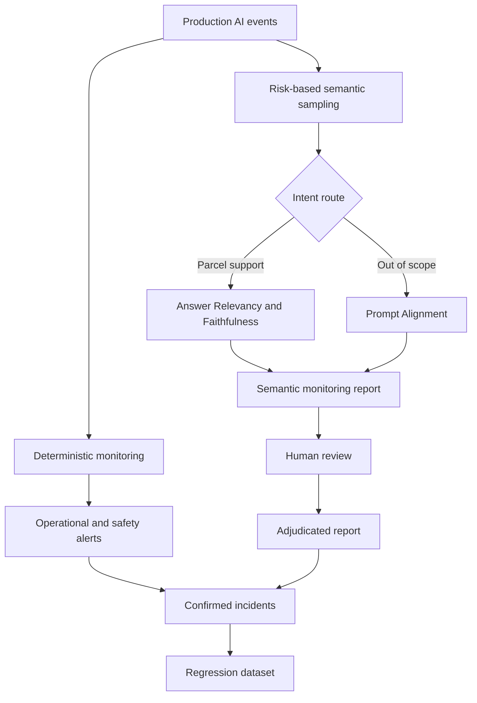

# Production AI Monitoring and Evaluation Suite

This module demonstrates how to monitor an AI application after release.

Pre-release evaluation determines whether a model is suitable for deployment.
Production monitoring determines whether the deployed system continues to behave
safely, accurately and reliably with real traffic.

The example system is a digital parcel-support chatbot.

## What This Suite Demonstrates

- Operational monitoring
- Safety and policy monitoring
- Intent-distribution drift detection
- Sampled semantic evaluation
- Intent-based metric routing
- Human review and evaluator adjudication
- Production incident conversion into regression tests
- Automated pytest coverage

## Monitoring Architecture



## Why Metric Routing Is Required

One metric should not evaluate every production interaction.

Parcel-support responses require grounded-answer evaluation:

- Answer Relevancy
- Faithfulness

Out-of-scope requests require role-boundary evaluation:

- Prompt Alignment

Operational failures and known safety incidents use deterministic signals:

- Application error
- PII incident
- Policy violation
- Unsupported action claim

This prevents unrelated refusals from being incorrectly evaluated as normal
question-answering responses.

## Monitored Signals

### Operational

- Error rate
- P95 latency
- Negative feedback rate
- Token usage
- Estimated cost

### Safety and Policy

- Policy violations
- PII incidents
- Unsupported action claims
- Application errors

### Drift

- Intent-distribution shift
- Unknown-intent rate
- Maximum intent shift from the approved baseline

### Semantic Quality

- Answer Relevancy
- Faithfulness
- Prompt Alignment
- Semantic pass rate
- Evaluation execution errors

## Example Results

### Healthy Production Window

| Signal | Result |
|---|---:|
| Events | 20 |
| Error rate | 0.00% |
| P95 latency | 1455 ms |
| Negative feedback | 5.00% |
| Policy violations | 0 |
| PII incidents | 0 |
| Unsupported action claims | 0 |
| Maximum intent shift | 0.00% |
| Monitoring status | HEALTHY |

Sampled semantic evaluation:

| Metric | Result |
|---|---:|
| Evaluated events | 5 |
| Answer Relevancy | 1.00 |
| Faithfulness | 0.90 |
| Automated semantic pass rate | 80.00% |
| Human-adjudicated pass rate | 100.00% |

One automated Faithfulness failure was reviewed and classified as an evaluator
false positive.

### Degraded Production Window

| Signal | Result |
|---|---:|
| Events | 12 |
| Error rate | 8.33% |
| P95 latency | 6200 ms |
| Negative feedback | 58.33% |
| Policy violations | 6 |
| PII incidents | 1 |
| Unsupported action claims | 1 |
| Unknown-intent rate | 33.33% |
| Maximum intent shift | 33.33% |
| Monitoring status | ALERT |

Routed semantic evaluation:

| Metric | Result |
|---|---:|
| Evaluated events | 9 |
| Grounded-response evaluations | 4 |
| Role-boundary evaluations | 5 |
| Evaluation errors | 0 |
| Answer Relevancy | 0.75 |
| Faithfulness | 0.00 |
| Prompt Alignment | 0.60 |
| Semantic pass rate | 33.33% |

## Human Review

LLM-as-a-judge results are not treated as unquestionable truth.

The suite preserves:

1. Automated metric result
2. Human or SME review
3. Final adjudicated result
4. Review rationale
5. False-positive classification

In this portfolio example, the human review is simulated. In production,
independent BA or SME approval would be required.

## Production-to-Regression Feedback Loop

Confirmed production failures are converted into reusable regression cases.

The degraded window generated seven regression cases:

- Five policy or semantic failures
- One application error
- One additional role-boundary failure
- Two critical cases involving privacy or unsupported actions

This creates a continuous feedback loop:

```text
Production incident
→ monitoring alert
→ investigation
→ human confirmation
→ regression test
→ pre-release quality gate
```

## Project Structure

```text
24_production_monitoring_suite/
├── data/
│   ├── healthy_production_events.jsonl
│   ├── degraded_production_events.jsonl
│   ├── human_feedback.jsonl
│   └── production_regression_cases.json
├── reports/
│   ├── healthy_monitoring_routed.json
│   ├── degraded_monitoring_routed.json
│   └── healthy_monitoring_adjudicated.json
├── tests/
│   ├── conftest.py
│   └── test_production_monitoring.py
├── apply_human_reviews.py
├── create_regression_cases.py
├── generate_production_events.py
├── human_review_labels.json
├── monitor_production.py
├── monitoring_config.json
├── parcel_support_policy.txt
├── production_baseline.json
├── requirements.txt
├── HOW_TO_RUN.txt
└── README.md
```

## Automated Test Results

```text
5 passed
```

The automated tests verify:

- Healthy monitoring behaviour
- Degraded-window alert generation
- Human adjudication
- Production-to-regression conversion
- Removal of raw payment data from regression artifacts

## Important Production Principles

- Monitor the complete AI system, not only the model.
- Use deterministic checks for known critical risks.
- Use semantic evaluation selectively because it has cost and latency.
- Route different intents to appropriate metrics.
- Treat evaluator errors separately from application failures.
- Calibrate LLM judges against human-reviewed labels.
- Preserve raw and adjudicated results for auditability.
- Convert confirmed production incidents into regression coverage.
- Never store unredacted sensitive information in evaluation datasets.

## Technology

- Python
- DeepEval
- OpenAI
- pytest
- JSON and JSONL monitoring artifacts

## Disclaimer

All production events, customer details and incidents in this module are
synthetic and created for demonstration purposes.