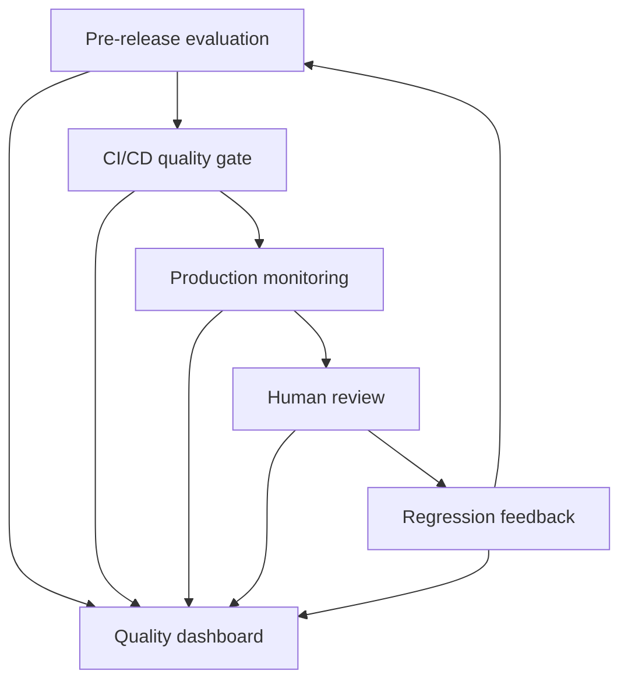

# AI Quality Dashboard and Governance Suite

This module demonstrates how multiple AI quality signals can be consolidated
into one explainable governance decision.

It combines:

- Pre-release AI evaluation
- CI/CD quality-gate results
- Production monitoring
- Human-review outcomes
- Production-to-regression feedback
- Automated release enforcement
- Management-friendly HTML reporting

The objective is not merely to display metric scores. The objective is to help
QA, product and engineering stakeholders decide whether an AI system should be
approved, conditionally approved or blocked.

---

## AI Quality Lifecycle



---

## Governance Decisions

The suite produces one of three decisions:

| Decision | Meaning |
|---|---|
| `APPROVE` | All configured quality gates passed |
| `CONDITIONAL` | No blocking failure exists, but non-critical risks require action |
| `BLOCK` | At least one release-blocking risk remains unresolved |

The decision rules are stored in `dashboard_config.json` rather than being
hidden inside the dashboard presentation.

---

## Sample Scenario

The included portfolio scenario demonstrates that passing pre-release tests
does not guarantee healthy production behaviour.

| Lifecycle stage | Result |
|---|---|
| Pre-release evaluation | PASS |
| CI/CD release gate | PASS |
| Production monitoring | ALERT |
| Human review | COMPLETED |
| Regression cases created | 7 |
| Overall governance decision | BLOCK |

The release is blocked because production monitoring detected:

- Three unresolved critical alerts
- One PII incident
- One unsupported action claim

---

## Quality Results

The generated sample produces:

| Result | Value |
|---|---:|
| Quality score | 41.18% |
| Total checks | 12 |
| Passed checks | 5 |
| Failed checks | 7 |
| Blocking failures | 3 |
| Regression cases | 7 |
| Final decision | BLOCK |

---

## Release-Blocking Rules

The sample configuration blocks approval when any of the following occurs:

- CI/CD release gate failure
- Failed critical pre-release test
- Unresolved critical production alert
- Privacy or PII incident
- Unsupported action claim

Operational, latency, feedback and semantic-quality failures may create a
`CONDITIONAL` decision when no critical blocker exists.

---

## Repository Structure

```text
25_ai_quality_dashboard_suite/
├── data/
│   ├── cicd_quality_gate_results.json
│   ├── human_review_results.json
│   ├── pre_release_results.json
│   ├── production_monitoring_results.json
│   └── regression_feedback_results.json
├── reports/
│   ├── ai_quality_dashboard.html
│   └── ai_quality_summary.json
├── templates/
│   └── dashboard.html
├── dashboard_config.json
├── generate_quality_dashboard.py
├── generate_sample_data.py
├── test_quality_dashboard.py
├── requirements.txt
├── HOW_TO_RUN.txt
└── README.md
```

---

## Main Components

### `dashboard_config.json`

Defines:

- Quality thresholds
- Release-blocking rules
- Decision meanings
- Input data sources
- Report output paths

### `generate_sample_data.py`

Creates deterministic portfolio data representing the full AI quality
lifecycle.

### `generate_quality_dashboard.py`

Loads all lifecycle evidence, evaluates the governance rules and generates:

- Machine-readable JSON summary
- Human-readable HTML dashboard
- Optional CI-compatible exit code

### `test_quality_dashboard.py`

Validates:

- `APPROVE`, `CONDITIONAL` and `BLOCK` decisions
- Blocking-reason identification
- Weighted quality score
- Production-overrides-pre-release scenario
- HTML dashboard generation
- Reporting-mode exit code
- Enforcement-mode exit code

---

## Running the Suite

Install dependencies:

```bash
python -m pip install -r requirements.txt
```

Generate sample lifecycle data:

```bash
python generate_sample_data.py
```

Generate the dashboard in reporting mode:

```bash
python generate_quality_dashboard.py
```

Open the dashboard on macOS:

```bash
open reports/ai_quality_dashboard.html
```

Run automated tests:

```bash
pytest test_quality_dashboard.py -v
```

Run in enforced quality-gate mode:

```bash
python generate_quality_dashboard.py --enforce-gate
```

A `BLOCK` decision returns exit code `1`.

---

## Reporting Mode vs Enforcement Mode

| Mode | Use case | `BLOCK` exit code |
|---|---|---:|
| Reporting mode | Scheduled dashboard generation and monitoring | 0 |
| Enforcement mode | Deployment, promotion or release gate | 1 |

This separation allows a monitoring report to be generated successfully even
when the report contains serious quality alerts.

---

## Why This Matters

AI quality cannot be represented by a single metric.

A production-ready governance process must combine:

- Deterministic checks
- LLM-based semantic evaluation
- Safety and privacy signals
- Operational measurements
- Human adjudication
- Regression feedback
- Explicit release rules

This module demonstrates how those signals become a traceable and explainable
decision.

---

## Portfolio Scope

This is a portfolio simulation using representative parcel-support data.

In a production implementation:

- Results would be collected automatically from evaluation platforms,
  CI/CD systems and observability tools.
- Thresholds would be approved by QA, product, security, privacy and domain
  stakeholders.
- Human-review records would include reviewer identity and audit timestamps.
- Dashboard results would be retained according to organisational governance
  requirements.
- Blocking decisions would integrate with deployment and incident-management
  workflows.

---

## Interview Summary

> I built an end-to-end AI quality governance dashboard that combines
> pre-release evaluation, CI/CD gates, production monitoring, human review and
> regression feedback. The decision logic is configuration-driven and produces
> APPROVE, CONDITIONAL or BLOCK outcomes. It also supports reporting mode for
> scheduled dashboards and enforcement mode for CI/CD. In the demonstrated
> scenario, pre-release and CI/CD passed, but critical production risks caused
> the overall decision to be BLOCK, showing that AI testing must continue after
> deployment.